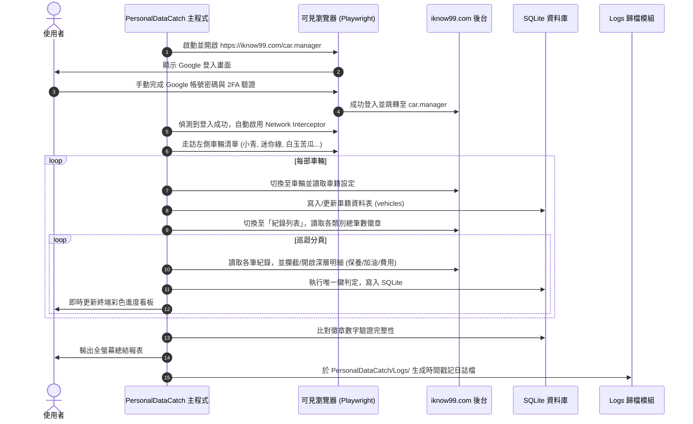

# iKnow99 車輛歷程資料擷取專案正式實作計劃書 (Implementation Plan)

* **專案名稱**：PersonalDataCatch (iKnow99 車輛歷程資料擷取模組)
* **規劃單位 / 作者**：Office of William
* **文件版本**：v1.0.0
* **建立日期**：2026-11-24 10:39:46
* **目標網站**：`https://iknow99.com/car.manager`
* **資料庫路徑**：`d:\iKnows99.Car\Database\iknow99_car.db`
* **日誌歸檔路徑**：`d:\iKnows99.Car\PersonalDataCatch\Logs\`

---

## 一、專案目標與三大資料類別定義

本專案旨在透過半自動化互動（使用者於可見視窗手動完成 Google 登入驗證，自動化程式接手監聽 API 並擷取資料）的方式，完整備份並結構化存儲 iknow99 上的車輛資料與所有歷程紀錄。

資料分類結構如下：

```
                    ┌── 1. 保養/維修 (工單、零件耗材、保養廠、施工明細)
車輛帳務與歷程 ───────┼── 2. 加油 (油品、公升數、單價、里程、計算油耗)
                    └── 3. 費用 (稅金、保險、通行費、停車、洗車、罰單等)
```

1. **車輛車籍設定 (Vehicles Settings)**：
   * 包含廠牌、車型、車款、車種、排氣量、馬力、燃料種類、車牌、暱稱、里程數、領牌日期、用途、油箱容量、備用油量、加油警示百分比等。
2. **保養/維修 (Maintenance & Repair)**：
   * 包含主檔（日期、時間、里程、總額、支付方式[現金/信用卡/轉帳/支票]、標題、備註）與工單細項（零件/項目、規格/細項、使用期限、使用里程、單價、數量、小計、備註）。
3. **加油 (Refueling)**：
   * 包含加油日期、時間、里程、總額、支付方式、加油量(公升)、油價($/公升)、燃料種類(95無鉛等)、上次加油無記錄勾選、加完油油表指針位置、即時油耗 6 大統計值（上次里程、行駛距離、油箱油量、上次油耗、上次平均成本、上次用油量）、備註與附件。
4. **費用 (Other Expenses)**：
   * 包含日期、時間、里程、總額、支付方式、自訂標題、8 大分類下拉選單（其他/洗車/停車/稅費/規費/保險/交通/旅程）、備註與附件。

---

## 二、系統流程與架構 (System Architecture)

採用 **Playwright 可見視窗 (Headed Browser) + API 流量攔截 (Network Interception)** 架構：



---

## 三、SQLite 資料庫綱要設計 (Database Schema)

資料庫儲存路徑：`d:\iKnows99.Car\Database\iknow99_car.db`

### 1. 車輛基本資料與車籍規格表 (`vehicles`)
```sql
CREATE TABLE IF NOT EXISTS vehicles (
    vehicle_id TEXT PRIMARY KEY,       -- 網站車輛 ID 或車牌
    plate_number TEXT,                 -- 車牌號碼
    nickname TEXT,                     -- 暱稱
    brand TEXT,                        -- 廠牌
    model TEXT,                        -- 車型
    trim TEXT,                         -- 車款
    car_type TEXT,                     -- 車種
    horsepower TEXT,                   -- 馬力
    displacement TEXT,                 -- 排氣量
    fuel_type TEXT,                    -- 燃料種類
    current_mileage INTEGER,           -- 目前里程數
    mileage_unit TEXT DEFAULT '公里',   -- 里程單位
    license_date DATE,                 -- 領牌日期
    vehicle_usage TEXT DEFAULT '自用車',-- 用途
    insurance_expiry_date DATE,        -- 保險到期日
    reminder_setting TEXT,             -- 提醒設置
    tank_capacity REAL,                -- 油箱容量
    fuel_efficiency_unit TEXT,         -- 油耗單位
    reserve_fuel_volume REAL,          -- 備用油油量
    fuel_warning_percentage INTEGER,   -- 加油警示百分比
    created_at TIMESTAMP DEFAULT CURRENT_TIMESTAMP,
    updated_at TIMESTAMP DEFAULT CURRENT_TIMESTAMP
);
```

### 2. 類別一：保養維修主表與明細表 (`maintenance_records`, `maintenance_items`, `maintenance_attachments`)
```sql
CREATE TABLE IF NOT EXISTS maintenance_records (
    record_id TEXT PRIMARY KEY,        -- 紀錄 ID (或指紋 Hash)
    vehicle_id TEXT,                   -- 關聯車輛 ID
    record_date DATE,                  -- 日期 (YYYY-MM-DD)
    record_time TEXT,                  -- 時間 (HH:MM)
    mileage INTEGER,                   -- 里程數 (公里)
    title TEXT,                        -- 標題 (例如：變速箱維修閥體)
    total_amount REAL,                 -- 總額
    payment_method TEXT,               -- 支付方式 (現金/信用卡/轉帳/支票)
    notes TEXT,                        -- 備註
    created_at TIMESTAMP DEFAULT CURRENT_TIMESTAMP,
    FOREIGN KEY (vehicle_id) REFERENCES vehicles(vehicle_id),
    UNIQUE(vehicle_id, record_date, record_time, title)
);

CREATE TABLE IF NOT EXISTS maintenance_items (
    item_id INTEGER PRIMARY KEY AUTOINCREMENT,
    record_id TEXT,                    -- 關聯 maintenance_records.record_id
    item_name TEXT,                    -- 零件/項目
    spec_detail TEXT,                  -- 規格/細項
    lifespan_date TEXT,                -- 使用期限
    lifespan_mileage INTEGER,          -- 使用里程
    unit_price REAL,                   -- 單價
    quantity REAL,                     -- 數量
    subtotal REAL,                     -- 小計
    remarks TEXT,                      -- 備註
    FOREIGN KEY (record_id) REFERENCES maintenance_records(record_id)
);

CREATE TABLE IF NOT EXISTS maintenance_attachments (
    attachment_id INTEGER PRIMARY KEY AUTOINCREMENT,
    record_id TEXT,                    -- 關聯 maintenance_records.record_id
    file_url TEXT,                     -- 遠端圖檔連結
    local_path TEXT,                   -- 本地端下載儲存路徑
    created_at TIMESTAMP DEFAULT CURRENT_TIMESTAMP,
    FOREIGN KEY (record_id) REFERENCES maintenance_records(record_id)
);
```

### 3. 類別二：加油紀錄表 (`refueling_records`, `refueling_attachments`)
```sql
CREATE TABLE IF NOT EXISTS refueling_records (
    record_id TEXT PRIMARY KEY,        -- 紀錄 ID (或指紋 Hash)
    vehicle_id TEXT,                   -- 關聯車輛 ID
    refuel_date DATE,                  -- 日期 (YYYY-MM-DD)
    refuel_time TEXT,                  -- 時間 (HH:MM)
    mileage INTEGER,                   -- 總里程 (公里)
    total_amount REAL,                 -- 總額
    payment_method TEXT,               -- 支付方式 (現金/信用卡/轉帳/支票)
    liters REAL,                       -- 加油量 (公升)
    unit_price REAL,                   -- 油價 ($/公升)
    fuel_type TEXT,                    -- 燃料種類 (95無鉛等)
    is_previous_missed INTEGER DEFAULT 0, -- 上次加油是否無記錄 (1: 是, 0: 否)
    fuel_gauge_position REAL,          -- 油表指針位置數值
    prev_mileage INTEGER,              -- 上次加油里程數 (公里)
    trip_distance REAL,                -- 本次行駛距離 (公里)
    tank_fuel_level REAL,              -- 油箱油量 (公升)
    fuel_efficiency REAL,              -- 上次油耗 (公里/公升)
    cost_per_km REAL,                  -- 上次平均成本 ($/公里)
    prev_fuel_used REAL,               -- 上次用油量 (公升)
    notes TEXT,                        -- 備註
    created_at TIMESTAMP DEFAULT CURRENT_TIMESTAMP,
    FOREIGN KEY (vehicle_id) REFERENCES vehicles(vehicle_id),
    UNIQUE(vehicle_id, refuel_date, refuel_time)
);

CREATE TABLE IF NOT EXISTS refueling_attachments (
    attachment_id INTEGER PRIMARY KEY AUTOINCREMENT,
    record_id TEXT,
    file_url TEXT,
    local_path TEXT,
    created_at TIMESTAMP DEFAULT CURRENT_TIMESTAMP,
    FOREIGN KEY (record_id) REFERENCES refueling_records(record_id)
);
```

### 4. 類別三：一般費用紀錄表 (`other_expense_records`, `expense_attachments`)
```sql
CREATE TABLE IF NOT EXISTS other_expense_records (
    record_id TEXT PRIMARY KEY,        -- 紀錄 ID (或指紋 Hash)
    vehicle_id TEXT,                   -- 關聯車輛 ID
    expense_date DATE,                 -- 日期 (YYYY-MM-DD)
    expense_time TEXT,                 -- 時間 (HH:MM)
    mileage INTEGER,                   -- 里程數 (公里)
    title TEXT,                        -- 標題 (例如：胎壓偵測器)
    expense_category TEXT,             -- 8大分類：其他/洗車/停車/稅費/規費/保險/交通/旅程
    total_amount REAL,                 -- 總額
    payment_method TEXT,               -- 支付方式 (現金/信用卡/轉帳/支票)
    notes TEXT,                        -- 備註說明
    created_at TIMESTAMP DEFAULT CURRENT_TIMESTAMP,
    FOREIGN KEY (vehicle_id) REFERENCES vehicles(vehicle_id),
    UNIQUE(vehicle_id, expense_date, expense_time, title)
);

CREATE TABLE IF NOT EXISTS expense_attachments (
    attachment_id INTEGER PRIMARY KEY AUTOINCREMENT,
    record_id TEXT,
    file_url TEXT,
    local_path TEXT,
    created_at TIMESTAMP DEFAULT CURRENT_TIMESTAMP,
    FOREIGN KEY (record_id) REFERENCES other_expense_records(record_id)
);
```

### 5. 彙整視圖與原始資料備份
```sql
CREATE VIEW IF NOT EXISTS v_all_expenses AS
SELECT 
    vehicle_id, 
    '保養維修' AS main_category, 
    title AS description, 
    record_date AS trans_date, 
    record_time AS trans_time, 
    mileage, 
    total_amount AS amount, 
    payment_method, 
    notes 
FROM maintenance_records
UNION ALL
SELECT 
    vehicle_id, 
    '加油' AS main_category, 
    fuel_type || ' (' || liters || '公升)' AS description, 
    refuel_date AS trans_date, 
    refuel_time AS trans_time, 
    mileage, 
    total_amount AS amount, 
    payment_method, 
    notes 
FROM refueling_records
UNION ALL
SELECT 
    vehicle_id, 
    expense_category AS main_category, 
    title AS description, 
    expense_date AS trans_date, 
    expense_time AS trans_time, 
    mileage, 
    total_amount AS amount, 
    payment_method, 
    notes 
FROM other_expense_records;

CREATE TABLE IF NOT EXISTS raw_data_logs (
    id INTEGER PRIMARY KEY AUTOINCREMENT,
    category TEXT,
    source_id TEXT,
    raw_json TEXT,
    created_at TIMESTAMP DEFAULT CURRENT_TIMESTAMP
);
```

---

## 四、模組檔案結構規劃 (`PersonalDataCatch`)

```text
iKnows99.Car/
├── .gemini/
│   └── rules/
│       └── documentation_rules.md    # 文檔輸出與命名規範
├── Database/
│   └── iknow99_car.db                # SQLite 本地資料庫
├── DocumentsAndInformations/         # 專案文檔目錄
│   ├── Implementation_plan_20261124103946.md
│   └── Implementation_plan_20261124103946.md.metadata.json
├── PersonalDataCatch/                # 核心擷取程式
│   ├── Logs/                         # 執行結果歷史歸檔目錄
│   │   └── Extraction_Report_YYYYMMDD_HHmmss.md
│   ├── requirements.txt              # 依賴模組 (playwright, rich 等)
│   ├── config.py                     # 全域路徑與常數配置
│   ├── db_manager.py                 # SQLite 初始化、去重與 Upsert 模組
│   ├── collector.py                  # Playwright 可見視窗引導、多車巡迴與 API 攔截
│   ├── reporter.py                   # Rich 彩色終端看板與 Logs 檔案生成
│   ├── main.py                       # 主程式流程控制與進入點
│   └── run.bat                       # Windows 一鍵快速啟動檔
```

---

## 五、實施時程與驗收標準

1. **Phase 1: 環境與 SQLite 資料庫建置**（完成）
2. **Phase 2: 瀏覽器互動登入與多車列表探勘**（完成）
3. **Phase 3: 紀錄列表多類別擷取與去重邏輯**（完成）
4. **Phase 4: 即時進度看板、螢幕報表與 Logs 歸檔**（完成）
5. **Phase 5: 交付與操作指導**（完成）

