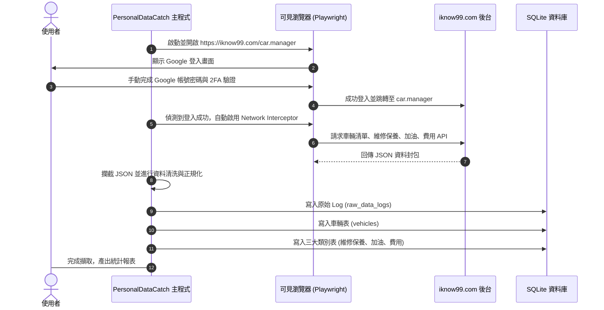

# iKnow99 車輛歷程資料擷取專案實作計劃書 (Implementation Plan)

* **專案名稱**：PersonalDataCatch (iKnow99 車輛歷程資料擷取模組)
* **文件作者**：Office of William
* **文件版本**：v1.0.0
* **目標網站**：`https://iknow99.com/car.manager`
* **資料庫路徑**：`d:\iKnows99.Car\Database\iknow99_car.db`

---

## 一、專案目標與三大資料類別定義

本專案旨在透過半自動化互動（使用者於可見視窗手動完成 Google 登入驗證，自動化程式接手監聽 API 並擷取資料）的方式，完整備份並結構化存儲 iknow99 上的車輛資料與所有歷程紀錄。

資料分類結構如下：

```
                    ┌── 1. 保養/維修 (工單、零件耗材、保養廠、施工明細)
車輛帳務與歷程 ───────┼── 2. 加油 (油品、公升數、單價、里程、計算油耗)
                    └── 3. 費用 (稅金、保險、通行費、停車、洗車、罰單等)
```

1. **保養/維修 (Maintenance & Repair)**：
   * 包含保養主檔（日期、當時里程、店家、總金額、備註）與明細表（零件項目、單價、數量、小計、工資）。
2. **加油 (Refueling)**：
   * 包含加油日期、里程、油品種類（92/95/98/柴油）、公升數、每公升單價、總金額、加油站名稱、是否加滿（用於油耗計算）。
3. **費用 (Other Expenses)**：
   * 包含稅金（牌照稅、燃料稅）、車險（乙式/丙式/強制險）、定期檢驗費、停車費、eTag 通行費、美容洗車、罰單等。

---

## 二、系統流程與架構 (System Architecture)

採用 **Playwright 可見視窗 (Headed Browser) + API 流量攔截 (Network Interception)** 架構：



---

## 三、SQLite 資料庫綱要設計 (Database Schema)

資料庫儲存路徑：`d:\iKnows99.Car\Database\iknow99_car.db`

### 1. 車輛基本資料表 (`vehicles`)
```sql
CREATE TABLE IF NOT EXISTS vehicles (
    vehicle_id TEXT PRIMARY KEY,       -- 網站內部車輛代碼或車牌
    plate_number TEXT,                 -- 車牌號碼
    nickname TEXT,                     -- 車輛暱稱
    brand TEXT,                        -- 廠牌 (如 Toyota, Honda)
    model TEXT,                        -- 型號 (如 RAV4, CR-V)
    manufacture_year INTEGER,          -- 出廠年份
    created_at TIMESTAMP DEFAULT CURRENT_TIMESTAMP,
    updated_at TIMESTAMP DEFAULT CURRENT_TIMESTAMP
);
```

### 2. 類別一：保養維修主表與明細表 (`maintenance_records`, `maintenance_items`)
```sql
-- 保養維修工單主檔
CREATE TABLE IF NOT EXISTS maintenance_records (
    record_id TEXT PRIMARY KEY,        -- 紀錄 ID
    vehicle_id TEXT,                   -- 關聯車輛 ID
    record_date DATE,                  -- 保養/維修日期
    mileage INTEGER,                   -- 當時里程 (km)
    shop_name TEXT,                    -- 保養廠 / 施工店家
    total_amount REAL,                 -- 總金額
    notes TEXT,                        -- 備註說明
    created_at TIMESTAMP DEFAULT CURRENT_TIMESTAMP,
    FOREIGN KEY (vehicle_id) REFERENCES vehicles(vehicle_id)
);

-- 保養維修工單細項表 (零件、工資明細)
CREATE TABLE IF NOT EXISTS maintenance_items (
    item_id INTEGER PRIMARY KEY AUTOINCREMENT,
    record_id TEXT,                    -- 關聯維修主檔 ID
    category TEXT,                     -- 耗材/工資/底盤/電系等
    item_name TEXT,                    -- 項目名稱 (如 機油5W40、工資)
    unit_price REAL,                   -- 單價
    quantity REAL,                     -- 數量
    subtotal REAL,                     -- 小計
    remarks TEXT,                      -- 單項備註
    FOREIGN KEY (record_id) REFERENCES maintenance_records(record_id)
);
```

### 3. 類別二：加油紀錄表 (`refueling_records`)
```sql
CREATE TABLE IF NOT EXISTS refueling_records (
    record_id TEXT PRIMARY KEY,        -- 加油紀錄 ID
    vehicle_id TEXT,                   -- 關聯車輛 ID
    refuel_date DATE,                  -- 加油日期
    mileage INTEGER,                   -- 當時里程數 (km)
    fuel_type TEXT,                    -- 油品 (92 / 95 / 98 / 柴油)
    liters REAL,                       -- 加油公升數
    unit_price REAL,                   -- 每公升單價
    total_amount REAL,                 -- 總金額
    is_full INTEGER DEFAULT 1,         -- 是否加滿 (1: 是, 0: 否，用於算油耗)
    gas_station TEXT,                  -- 加油站 (如 中油直營、台塑)
    calc_fuel_efficiency REAL,         -- 計算後油耗 (km/L)
    notes TEXT,                        -- 備註
    created_at TIMESTAMP DEFAULT CURRENT_TIMESTAMP,
    FOREIGN KEY (vehicle_id) REFERENCES vehicles(vehicle_id)
);
```

### 4. 類別三：一般費用紀錄表 (`other_expense_records`)
```sql
CREATE TABLE IF NOT EXISTS other_expense_records (
    record_id TEXT PRIMARY KEY,        -- 費用紀錄 ID
    vehicle_id TEXT,                   -- 關聯車輛 ID
    expense_date DATE,                 -- 費用產生日期
    expense_category TEXT,             -- 費用大類 (稅金、保險、通行費、停車、檢驗、美容、其他)
    expense_name TEXT,                 -- 項目說明 (如 牌照稅、富邦乙式車體險)
    amount REAL,                       -- 金額
    notes TEXT,                        -- 備註說明
    created_at TIMESTAMP DEFAULT CURRENT_TIMESTAMP,
    FOREIGN KEY (vehicle_id) REFERENCES vehicles(vehicle_id)
);
```

### 5. 彙整視圖與原始資料備份
```sql
-- 綜合費用總表視圖 (便於整體統計報表分析)
CREATE VIEW IF NOT EXISTS v_all_expenses AS
SELECT 
    vehicle_id, 
    '保養維修' AS main_category, 
    shop_name AS description, 
    record_date AS trans_date, 
    mileage, 
    total_amount AS amount 
FROM maintenance_records
UNION ALL
SELECT 
    vehicle_id, 
    '加油' AS main_category, 
    fuel_type || ' (' || gas_station || ')' AS description, 
    refuel_date AS trans_date, 
    mileage, 
    total_amount AS amount 
FROM refueling_records
UNION ALL
SELECT 
    vehicle_id, 
    expense_category AS main_category, 
    expense_name AS description, 
    expense_date AS trans_date, 
    NULL AS mileage, 
    amount 
FROM other_expense_records;

-- 原始 API 封包備份表
CREATE TABLE IF NOT EXISTS raw_data_logs (
    id INTEGER PRIMARY KEY AUTOINCREMENT,
    category TEXT,                     -- 'vehicle', 'maintenance', 'refueling', 'expense'
    source_id TEXT,
    raw_json TEXT,                     -- 完整回傳 JSON
    created_at TIMESTAMP DEFAULT CURRENT_TIMESTAMP
);
```

---

## 四、模組檔案結構規劃 (`PersonalDataCatch`)

```text
iKnows99.Car/
├── Database/
│   └── iknow99_car.db                # SQLite 本地資料庫
├── PersonalDataCatch/
│   ├── requirements.txt              # 模組依賴 (playwright, rich, pydantic 等)
│   ├── config.py                     # 系統設定 (URL、DB路徑、逾時設定等)
│   ├── db_manager.py                 # SQLite 建立、更新與批次寫入邏輯
│   ├── parser.py                     # 資料解析器 (處理三大類別格式轉換)
│   ├── browser_collector.py          # Playwright 瀏覽器啟動、登入導引與網路封包攔截
│   └── main.py                       # 主流程控制與 CLI 互動入口
```

---

## 五、實施階段與里程碑 (Implementation Phases)

| 階段 | 任務項目 | 產出與驗收標準 |
| :--- | :--- | :--- |
| **Phase 1: 環境與資料庫建置** | 1. 建立 `PersonalDataCatch` 與 `Database` 目錄<br>2. 建立 `requirements.txt`<br>3. 實作 `db_manager.py` 並初始化 SQLite Schema | SQLite 資料庫正確建立 5 張資料表與 1 個 View |
| **Phase 2: 互動式登入與網路攔截** | 1. 撰寫 `browser_collector.py`<br>2. 實作可見視窗引導 Google 登入<br>3. 實作 API 封包監聽器 (Listener) | 成功取得車輛清單、維修、加油、費用之原始 JSON 封包 |
| **Phase 3: 資料清洗與入庫邏輯** | 1. 撰寫 `parser.py` 解析三種資料格式<br>2. 處理字串、數值、日期轉換<br>3. 批次寫入對應 SQLite 表中 | 正確解析並完整寫入資料庫，不遺漏任何明細與備註 |
| **Phase 4: 整合測試與報表輸出** | 1. 執行端到端完整測試<br>2. 驗證資料筆數與總金額是否與網頁相符<br>3. 輸出車輛資料統計摘要 | 終端顯示擷取統計（車輛數、維修筆數、加油筆數、費用筆數） |
