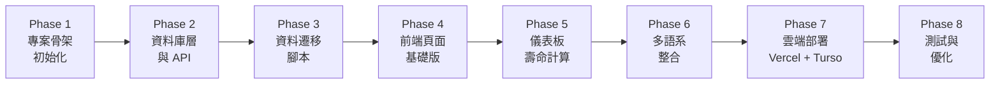

# CarVitals — 完整實作計劃

> **作者**：Office of William  
> **版本**：v1.0  
> **建立日期**：2026-11-25  
> **狀態**：草稿 — 待使用者確認後執行

---

## 一、專案概覽

**CarVitals** 是一套現代化車輛健康管理 Web 系統，以現有的 iknow99.com 功能為參考藍圖，採用完全獨立的技術架構開發，不複製任何原始碼或設計細節。

### 核心目標
| 目標 | 說明 |
|------|------|
| 🗂️ 資料輸入 | 加油、維修保養、其他費用的完整 CRUD 介面 |
| 📊 資料檢視 | 依車輛、類別、日期篩選的記錄清單 |
| 🚗 即時儀表板 | 顯示車輛當前狀態，包含零件壽命、即將到期提醒 |
| 🌐 多語系 | 繁體中文（預設）、英文，可擴充 |
| ☁️ 雲端部署 | Vercel + Turso 邊緣雲端，全球低延遲 |

---

## 二、核心技術堆疊（依 AegisSystem 架構規範）

```
CarVitals Tech Stack
├── 全端框架     : Next.js 14+ (App Router, Serverless/Edge 相容)
├── 前端 UI      : React 18+, Tailwind CSS, shadcn/ui 元件庫
├── 圖標庫       : Lucide React
├── 動畫轉場     : Framer Motion
├── 資料圖表     : Recharts
├── 多語系       : next-intl (支援 zh-TW / en)
├── 雲端資料庫   : Turso (LibSQL) — libsql/client SDK
├── 驗證安全     : bcryptjs + API Route 授權中介層
├── ORM 層       : 輕量 SQL Helper（不引入 Prisma，降低 Edge 相容複雜度）
├── 本地開發 DB  : SQLite (相容 LibSQL，可直接匯入現有 iknow99_car.db)
└── 部署 CI/CD   : Vercel ← GitHub (main branch 自動部署)
```

> [!IMPORTANT]
> **智財權聲明**：本系統僅參考 iknow99.com 的功能概念（維修、加油、費用記錄、零件壽命），不複製其任何 CSS 樣式、JS 邏輯、圖片資源或 UI 設計細節。

---

## 三、專案目錄結構

```
D:\iKnows99.Car\CarVitals\
├── app/
│   ├── [locale]/                    # 多語系路由包裝
│   │   ├── layout.tsx               # 多語系根版面
│   │   ├── page.tsx                 # 首頁（導向 Dashboard）
│   │   ├── login/
│   │   │   └── page.tsx             # 登入頁
│   │   ├── dashboard/
│   │   │   └── page.tsx             # 主儀表板（車輛狀態總覽）
│   │   ├── vehicles/
│   │   │   ├── page.tsx             # 車輛管理列表
│   │   │   └── [vehicleId]/
│   │   │       └── page.tsx         # 單車詳細資訊
│   │   ├── maintenance/
│   │   │   ├── page.tsx             # 維修保養紀錄列表
│   │   │   └── [recordId]/
│   │   │       └── page.tsx         # 維修工單詳細（含零件細項）
│   │   ├── refueling/
│   │   │   └── page.tsx             # 加油紀錄列表
│   │   └── expenses/
│   │       └── page.tsx             # 其他費用列表
│   ├── api/
│   │   ├── auth/
│   │   │   ├── login/route.ts       # POST 登入
│   │   │   └── logout/route.ts      # POST 登出
│   │   ├── vehicles/
│   │   │   ├── route.ts             # GET 全部車輛 / POST 新增
│   │   │   └── [vehicleId]/route.ts # GET/PUT/DELETE 單車
│   │   ├── maintenance/
│   │   │   ├── route.ts             # GET 列表 / POST 新增工單
│   │   │   └── [recordId]/
│   │   │       ├── route.ts         # GET/PUT/DELETE 工單
│   │   │       └── items/route.ts   # GET/POST 零件細項
│   │   ├── refueling/
│   │   │   └── route.ts             # GET 列表 / POST 新增加油
│   │   ├── expenses/
│   │   │   └── route.ts             # GET 列表 / POST 新增費用
│   │   └── dashboard/
│   │       └── status/route.ts      # GET 車輛健康狀態計算
│   ├── layout.tsx                   # 全域根版面（字型、主題）
│   └── globals.css                  # 全域樣式
├── components/
│   ├── ui/                          # shadcn/ui 基礎元件
│   ├── layout/
│   │   ├── Navbar.tsx               # 頂部導覽列（含語系切換器）
│   │   ├── Sidebar.tsx              # 車輛切換側邊欄
│   │   └── LanguageSwitcher.tsx     # 語系切換按鈕
│   ├── dashboard/
│   │   ├── VehicleStatusCard.tsx    # 車輛狀態卡片
│   │   ├── ComponentHealthBar.tsx   # 零件壽命進度條
│   │   ├── AlertPanel.tsx           # 到期提醒面板
│   │   └── MileageChart.tsx         # 里程/費用趨勢圖（Recharts）
│   ├── maintenance/
│   │   ├── MaintenanceList.tsx      # 維修紀錄列表
│   │   ├── MaintenanceForm.tsx      # 新增/編輯工單表單
│   │   └── MaintenanceItemTable.tsx # 零件細項表格
│   ├── refueling/
│   │   ├── RefuelingList.tsx        # 加油紀錄列表
│   │   └── RefuelingForm.tsx        # 新增/編輯加油表單
│   └── expenses/
│       ├── ExpenseList.tsx          # 其他費用列表
│       └── ExpenseForm.tsx          # 新增/編輯費用表單
├── lib/
│   ├── db.ts                        # Turso LibSQL 單例連線（本地開發相容 SQLite）
│   ├── auth.ts                      # Session / Cookie 授權工具
│   ├── health.ts                    # 車輛健康狀態計算邏輯（零件壽命演算法）
│   └── i18n.ts                      # next-intl 設定
├── messages/
│   ├── zh-TW.json                   # 繁體中文語系包
│   └── en.json                      # 英文語系包
├── scripts/
│   ├── init-db.mjs                  # 初始化 Turso 資料表結構
│   └── migrate-sqlite.mjs           # 將 iknow99_car.db 資料遷移至 Turso
├── middleware.ts                    # Next.js 多語系路由中介層
├── .env.local                       # 本地環境變數（不入 Git）
├── .env.example                     # 環境變數範例
├── next.config.mjs                  # Next.js 設定（plugin: next-intl）
├── tailwind.config.ts               # Tailwind 設定
├── tsconfig.json                    # TypeScript 設定
└── package.json
```

---

## 四、資料庫設計

### 4.1 策略：雙模式相容設計

| 環境 | 資料庫 | 說明 |
|------|--------|------|
| 本地開發 | SQLite (`.db` 檔案) | 直接使用現有 `iknow99_car.db`，零設定 |
| 正式生產 | Turso (LibSQL 雲端) | 相同 SQL 語法，換環境變數即可切換 |

> [!TIP]
> LibSQL 是 SQLite 的開源分支，語法 100% 相容，本地開發完全不需要安裝額外資料庫服務。

### 4.2 現有 Schema（來自 `iknow99_car.db`，共 957 筆資料）

```
vehicles            : 3 筆  — vehicle_id, plate_number, nickname, brand, model,
                              trim, car_type, horsepower, displacement, fuel_type,
                              current_mileage, mileage_unit, license_date, 
                              vehicle_usage, insurance_expiry_date, reminder_setting,
                              tank_capacity, fuel_efficiency_unit, reserve_fuel_volume,
                              fuel_warning_percentage, created_at, updated_at

maintenance_records : 65 筆 — record_id, vehicle_id, record_date, record_time,
                              mileage, title, total_amount, payment_method, 
                              notes, created_at

maintenance_items   : 239 筆 — item_id, record_id, item_name, spec_detail,
                               lifespan_date, lifespan_mileage, unit_price,
                               quantity, subtotal, remarks, created_at

refueling_records   : 477 筆 — record_id, vehicle_id, refuel_date, refuel_time,
                               mileage, total_amount, payment_method, liters,
                               unit_price, fuel_type, is_previous_missed,
                               fuel_gauge_position, prev_mileage, trip_distance,
                               tank_fuel_level, fuel_efficiency, cost_per_km,
                               prev_fuel_used, notes, created_at

other_expense_records: 173 筆 — record_id, vehicle_id, expense_date, expense_time,
                                mileage, title, expense_category, total_amount,
                                payment_method, notes, created_at
```

### 4.3 CarVitals 擴充資料表（新增）

```sql
-- 使用者帳號（單人或多人管理）
CREATE TABLE IF NOT EXISTS users (
  id           INTEGER PRIMARY KEY AUTOINCREMENT,
  username     TEXT UNIQUE NOT NULL,
  password_hash TEXT NOT NULL,
  role         TEXT DEFAULT 'owner',  -- owner / viewer
  created_at   DATETIME DEFAULT CURRENT_TIMESTAMP
);

-- 零件壽命警示設定（獨立於維修記錄，可自訂設定）
CREATE TABLE IF NOT EXISTS component_alerts (
  alert_id        INTEGER PRIMARY KEY AUTOINCREMENT,
  vehicle_id      TEXT NOT NULL REFERENCES vehicles(vehicle_id),
  component_name  TEXT NOT NULL,          -- 如「機油」、「煞車皮」
  last_replaced_date DATE,
  last_replaced_mileage INTEGER,
  lifespan_days   INTEGER,                -- 日期壽命（天）
  lifespan_km     INTEGER,                -- 里程壽命（公里）
  alert_days_before INTEGER DEFAULT 30,  -- 提前幾天警示
  alert_km_before  INTEGER DEFAULT 500,  -- 提前幾公里警示
  created_at      DATETIME DEFAULT CURRENT_TIMESTAMP,
  updated_at      DATETIME DEFAULT CURRENT_TIMESTAMP
);
```

---

## 五、核心功能模組規格

### 5.1 🚗 儀表板（Dashboard）— 核心賣點

**車輛狀態計算邏輯**（`lib/health.ts`）：

```
對每台車的每個零件：
  剩餘日期壽命 = (最後更換日期 + 壽命天數) - 今天
  剩餘里程壽命 = (最後更換里程 + 壽命公里) - 當前里程

  狀態判斷：
    🟢 正常  → 剩餘日期 > 警示天數 AND 剩餘里程 > 警示里程
    🟡 警示  → 剩餘日期 ≤ 警示天數 OR 剩餘里程 ≤ 警示里程
    🔴 逾期  → 剩餘日期 ≤ 0 OR 剩餘里程 ≤ 0
```

**Dashboard 顯示內容**：
- 車輛概覽卡片（車牌、暱稱、當前里程、保險到期）
- 零件壽命進度條（依狀態著色）
- 逾期/即將到期提醒清單
- 本月費用摘要（維修 + 加油 + 其他）
- 油耗趨勢折線圖（最近 N 次加油）

### 5.2 📋 維修保養模組

| 功能 | 路由 | 說明 |
|------|------|------|
| 紀錄列表 | `/maintenance` | 依車輛篩選，含工單日期、里程、金額 |
| 工單詳細 | `/maintenance/[recordId]` | 顯示工單 + 零件細項表格 |
| 新增工單 | 表單（Modal 或獨立頁） | 工單主檔 + 動態新增零件細項 |
| 編輯/刪除 | PUT/DELETE API | 完整 CRUD |

**零件細項欄位**：品項名稱、規格說明、日期壽命、里程壽命、單價、數量、小計、備註

### 5.3 ⛽ 加油紀錄模組

| 功能 | 說明 |
|------|------|
| 紀錄列表 | 依車輛篩選，顯示日期、公升、金額、油耗 |
| 自動計算 | 根據上次里程自動計算本次油耗、每公里成本 |
| 趨勢圖 | Recharts 油耗歷史折線圖 |
| 新增/編輯 | 完整表單，支援漏加油標記 |

### 5.4 💰 其他費用模組

| 功能 | 說明 |
|------|------|
| 紀錄列表 | 依車輛、費用類別篩選 |
| 費用類別 | 罰單、洗車、停車、過路費、保險等（可自訂） |
| 新增/編輯 | 完整 CRUD |

### 5.5 🌐 多語系實作（next-intl）

```
支援語系：
  zh-TW (繁體中文) — 預設
  en (English)

實作方式：
  - App Router: app/[locale]/... 動態語系路由
  - middleware.ts: 語系偵測與重定向
  - messages/zh-TW.json: 所有 UI 文字的鍵值對
  - messages/en.json: 英文對應翻譯
  - 語系切換器：右上角下拉選單，切換後保留當前頁面路由
```

---

## 六、API 路由規格

```
POST   /api/auth/login          → 驗證帳密，設定加密 Cookie
POST   /api/auth/logout         → 清除 Session Cookie

GET    /api/vehicles            → 取得所有車輛
POST   /api/vehicles            → 新增車輛
GET    /api/vehicles/:id        → 取得單車詳細
PUT    /api/vehicles/:id        → 更新車輛資料
DELETE /api/vehicles/:id        → 刪除車輛

GET    /api/maintenance         → 維修紀錄列表（?vehicleId=&page=&limit=）
POST   /api/maintenance         → 新增維修工單（含零件細項）
GET    /api/maintenance/:id     → 取得工單詳細（含零件細項）
PUT    /api/maintenance/:id     → 更新工單
DELETE /api/maintenance/:id     → 刪除工單

GET    /api/maintenance/:id/items    → 取得零件細項
POST   /api/maintenance/:id/items   → 新增零件細項

GET    /api/refueling           → 加油紀錄列表（?vehicleId=&page=）
POST   /api/refueling           → 新增加油紀錄
PUT    /api/refueling/:id       → 更新加油記錄
DELETE /api/refueling/:id       → 刪除加油記錄

GET    /api/expenses            → 其他費用列表（?vehicleId=&category=）
POST   /api/expenses            → 新增費用記錄
PUT    /api/expenses/:id        → 更新費用記錄
DELETE /api/expenses/:id        → 刪除費用記錄

GET    /api/dashboard/status    → 車輛健康狀態計算結果
```

> [!NOTE]
> 所有非公開 API 路由皆需驗證 Cookie Session，未授權請求返回 `401 Unauthorized`。

---

## 七、資料遷移策略

### 現有資料 → CarVitals

```
iknow99_car.db (SQLite)
        │
        ▼
scripts/migrate-sqlite.mjs
  1. 讀取本地 iknow99_car.db 所有資料
  2. 轉換欄位格式（如時間戳記標準化）
  3. 寫入 Turso 雲端資料庫（INSERT OR IGNORE）
        │
        ▼
Turso LibSQL (雲端)
  - 完整 957 筆歷史資料
  - 三台車輛完整紀錄
```

**本地開發模式**（零設定）：
- 設定 `TURSO_DATABASE_URL=file:../../Database/iknow99_car.db`
- LibSQL client 自動對應本地 SQLite 檔案

---

## 八、前置作業清單（使用者確認前可執行）

- [x] Prompt 文件已讀取完畢
- [x] SQLite schema 已確認（9 個資料表，957 筆資料）
- [x] CarVitals 目錄已存在（`D:\iKnows99.Car\CarVitals`，空目錄）
- [ ] 確認 Node.js 版本（需 ≥ 18）
- [ ] 確認 Turso CLI 是否已安裝或需要安裝指引
- [ ] 使用者確認是否需要登入驗證功能（單人使用可選）
- [ ] 使用者確認 Vercel 帳號連結與 GitHub Repo 名稱

---

## 九、開發里程碑



| 里程碑 | 內容 | 預估工作量 |
|--------|------|-----------|
| Phase 1 | `npx create-next-app` 骨架、Tailwind、shadcn/ui、next-intl 設定 | 0.5 天 |
| Phase 2 | `lib/db.ts` 連線模組、全部 API Route Handler、資料表初始化 | 1.5 天 |
| Phase 3 | `scripts/migrate-sqlite.mjs` 遷移腳本，驗證資料完整性 | 0.5 天 |
| Phase 4 | 車輛列表、維修/加油/費用的 CRUD 頁面（無樣式優化） | 2 天 |
| Phase 5 | Dashboard 儀表板、`lib/health.ts` 壽命計算、Recharts 圖表 | 1.5 天 |
| Phase 6 | `messages/zh-TW.json`、`messages/en.json`、LanguageSwitcher 元件 | 0.5 天 |
| Phase 7 | Turso 雲端建立、Vercel 部署設定、環境變數配置 | 0.5 天 |
| Phase 8 | 跨瀏覽器測試、RWD 優化、效能分析 | 1 天 |

**總預估**：約 8 個工作天（全速開發）

---

## 十、前置環境需求確認

> [!WARNING]
> 以下項目在正式開始實作前需要確認或安裝：

```powershell
# 確認 Node.js 版本（需 ≥ 18）
node --version

# 確認 npm 版本
npm --version

# （選用）安裝 Turso CLI 用於本地管理
# winget install turso

# （選用）確認 Git 設定
git config user.name
git config user.email
```

---

## 十一、開放決策項目

以下項目需要使用者確認後才能定案：

| # | 決策項目 | 選項 A | 選項 B |
|---|---------|--------|--------|
| 1 | 是否需要登入驗證？ | 是（bcryptjs + Cookie） | 否（無需登入，單機使用） |
| 2 | 多語系初始版本？ | zh-TW + en | 僅 zh-TW（後續擴充） |
| 3 | 資料庫正式環境？ | Turso 雲端（需帳號） | 繼續使用本地 SQLite |
| 4 | UI 主題色系？ | 深色（Dark Mode 優先） | 淺色（Light Mode 優先） |
| 5 | Vercel 部署時機？ | Phase 1 完成即部署 | 等 Phase 4 基礎功能完成 |

---

*本文件由 **Office of William** 製作，版本 v1.0，2026-11-25*
