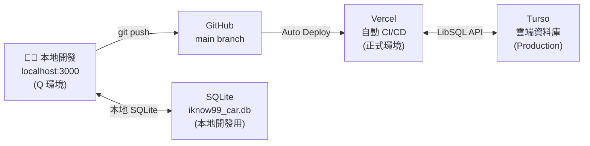
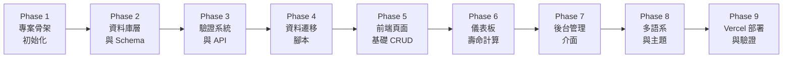

# CarVitals — 完整實作計劃 v2.0

> **作者**：Office of William  
> **版本**：v2.0（決策已確認定案）  
> **建立日期**：2026-11-25  
> **更新日期**：2026-11-25  
> **狀態**：✅ 決策定案 — 等待執行指令

---

## 一、已確認決策（全部定案）

| # | 決策項目 | 確認結果 |
|---|---------|---------|
| 1 | 登入驗證 | ✅ **需要**，附後台管理（使用者管理 + 數據管理） |
| 2 | 多語系 | ✅ **zh-TW + en**，預設繁體中文 |
| 3 | 資料庫 | ✅ **Turso 雲端**（LibSQL），本地開發以 SQLite 相容模式 |
| 4 | UI 主題 | ✅ **深色優先**，每位 User 可自選深色 / 淺色 |
| 5 | 部署策略 | ✅ **GitHub ↔ Vercel 自動 CI/CD**，localhost = Q環境，Vercel = 正式環境 |

### 環境架構定義
```
localhost:3000     → Q 環境（本地開發驗證，對應 SQLite 或 Turso Dev DB）
Vercel (main)      → 正式環境（Production，Git push 後自動觸發 CI/CD）

※ 無獨立 Staging Server，Q 環境即 localhost
```

---

## 二、專案概覽

**CarVitals** 是一套現代化車輛健康管理 Web 系統，以現有的 iknow99.com 功能為參考藍圖，採用完全獨立的技術架構開發，不複製任何原始碼或設計細節。

### 核心目標
| 目標 | 說明 |
|------|------|
| 🔐 多用戶驗證 | 登入 / 登出 / 角色權限（Owner / Viewer / Admin） |
| 🛠️ 後台管理 | 使用者管理、全車輛數據總覽、系統日誌 |
| 🗂️ 資料輸入 | 加油、維修保養、其他費用的完整 CRUD 介面 |
| 📊 資料檢視 | 依車輛、類別、日期篩選的記錄清單 |
| 🚗 即時儀表板 | 顯示車輛當前狀態，含零件壽命、即將到期提醒 |
| 🌐 多語系 | 繁體中文（預設）、英文，可擴充 |
| 🌓 主題切換 | 深色優先，每位 User 可自選主題並持久化 |
| ☁️ 雲端部署 | Vercel + Turso 邊緣雲端，GitHub 自動 CI/CD |

---

## 三、核心技術堆疊

```
CarVitals Tech Stack
│
├── 全端框架     : Next.js 14+ (App Router, Serverless/Edge 相容)
├── 語言         : TypeScript
│
├── 前端 UI
│   ├── React 18+
│   ├── Tailwind CSS      — 樣式系統
│   ├── shadcn/ui         — 元件庫（Button, Form, Table, Dialog...）
│   ├── Lucide React      — 圖標庫
│   ├── Framer Motion     — 轉場動畫
│   └── Recharts          — 資料圖表
│
├── 多語系       : next-intl（App Router 整合）
│
├── 主題切換     : next-themes（dark/light，User 偏好持久化）
│
├── 雲端資料庫   : Turso (LibSQL) — @libsql/client SDK
│   └── 本地開發  : SQLite (LibSQL 相容，直接用 iknow99_car.db)
│
├── 驗證安全
│   ├── bcryptjs          — 密碼雜湊
│   ├── jose              — JWT 產生與驗證
│   └── HTTP-only Cookie  — Session 儲存（防 XSS）
│
└── 部署 CI/CD   : GitHub main → Vercel 自動建置
```

> [!IMPORTANT]
> **智財權聲明**：本系統僅參考 iknow99.com 的功能概念，不複製其任何 CSS 樣式、JS 邏輯、圖片資源或 UI 設計細節。

---

## 四、專案目錄結構

```
D:\iKnows99.Car\CarVitals\
│
├── app/
│   ├── [locale]/                        # 多語系路由包裝 (zh-TW / en)
│   │   ├── layout.tsx                   # 多語系根版面（Navbar, Sidebar, ThemeProvider）
│   │   ├── page.tsx                     # 首頁 → 導向 /dashboard
│   │   │
│   │   ├── login/
│   │   │   └── page.tsx                 # 登入頁面
│   │   │
│   │   ├── dashboard/
│   │   │   └── page.tsx                 # 主儀表板（車輛狀態總覽）
│   │   │
│   │   ├── vehicles/
│   │   │   ├── page.tsx                 # 車輛管理列表
│   │   │   └── [vehicleId]/page.tsx     # 單車詳細資訊
│   │   │
│   │   ├── maintenance/
│   │   │   ├── page.tsx                 # 維修保養紀錄列表
│   │   │   └── [recordId]/page.tsx      # 工單詳細（含零件細項表）
│   │   │
│   │   ├── refueling/
│   │   │   └── page.tsx                 # 加油紀錄列表
│   │   │
│   │   ├── expenses/
│   │   │   └── page.tsx                 # 其他費用列表
│   │   │
│   │   └── admin/                       # 後台管理（Admin 角色限定）
│   │       ├── layout.tsx               # 後台版面（獨立 Sidebar）
│   │       ├── page.tsx                 # 後台首頁 → 數據總覽
│   │       ├── users/
│   │       │   └── page.tsx             # 使用者管理（新增/編輯/停用）
│   │       ├── vehicles/
│   │       │   └── page.tsx             # 全車輛數據總覽
│   │       └── logs/
│   │           └── page.tsx             # 系統日誌檢視
│   │
│   ├── api/
│   │   ├── auth/
│   │   │   ├── login/route.ts           # POST：登入，發 JWT Cookie
│   │   │   ├── logout/route.ts          # POST：登出，清除 Cookie
│   │   │   └── me/route.ts              # GET：取得當前登入 User 資訊
│   │   │
│   │   ├── vehicles/
│   │   │   ├── route.ts                 # GET 全部 / POST 新增
│   │   │   └── [vehicleId]/route.ts     # GET / PUT / DELETE
│   │   │
│   │   ├── maintenance/
│   │   │   ├── route.ts                 # GET 列表 / POST 新增工單
│   │   │   └── [recordId]/
│   │   │       ├── route.ts             # GET / PUT / DELETE 工單
│   │   │       └── items/route.ts       # GET / POST 零件細項
│   │   │
│   │   ├── refueling/
│   │   │   ├── route.ts                 # GET 列表 / POST 新增
│   │   │   └── [recordId]/route.ts      # PUT / DELETE
│   │   │
│   │   ├── expenses/
│   │   │   ├── route.ts                 # GET 列表 / POST 新增
│   │   │   └── [recordId]/route.ts      # PUT / DELETE
│   │   │
│   │   ├── dashboard/
│   │   │   └── status/route.ts          # GET：車輛健康狀態計算
│   │   │
│   │   └── admin/
│   │       ├── users/route.ts           # GET / POST 使用者管理
│   │       ├── users/[userId]/route.ts  # PUT / DELETE 使用者
│   │       └── logs/route.ts            # GET 系統日誌
│   │
│   ├── layout.tsx                       # 全域根版面（字型、ThemeProvider）
│   └── globals.css                      # 全域樣式（Tailwind base）
│
├── components/
│   ├── ui/                              # shadcn/ui 基礎元件（自動生成）
│   ├── layout/
│   │   ├── Navbar.tsx                   # 頂部導覽列（Logo、User選單、語系切換、主題切換）
│   │   ├── Sidebar.tsx                  # 車輛切換側邊欄 + 主選單
│   │   ├── AdminSidebar.tsx             # 後台管理側邊欄
│   │   ├── LanguageSwitcher.tsx         # 語系切換下拉
│   │   └── ThemeToggle.tsx              # 深色/淺色切換按鈕
│   │
│   ├── dashboard/
│   │   ├── VehicleStatusCard.tsx        # 車輛狀態卡片（車牌、里程、保險）
│   │   ├── ComponentHealthBar.tsx       # 零件壽命進度條（綠/黃/紅）
│   │   ├── AlertPanel.tsx               # 到期提醒面板
│   │   ├── MileageChart.tsx             # 里程/費用趨勢圖（Recharts）
│   │   └── FuelEfficiencyChart.tsx      # 油耗趨勢折線圖
│   │
│   ├── maintenance/
│   │   ├── MaintenanceList.tsx          # 維修紀錄列表（含分頁）
│   │   ├── MaintenanceForm.tsx          # 新增/編輯工單表單
│   │   └── MaintenanceItemTable.tsx     # 零件細項表格（內嵌編輯）
│   │
│   ├── refueling/
│   │   ├── RefuelingList.tsx            # 加油紀錄列表
│   │   └── RefuelingForm.tsx            # 新增/編輯加油表單
│   │
│   ├── expenses/
│   │   ├── ExpenseList.tsx              # 其他費用列表
│   │   └── ExpenseForm.tsx              # 新增/編輯費用表單
│   │
│   └── admin/
│       ├── UserTable.tsx                # 使用者管理表格
│       ├── UserForm.tsx                 # 新增/編輯使用者表單
│       └── SystemLogViewer.tsx          # 系統日誌檢視器
│
├── lib/
│   ├── db.ts                            # Turso LibSQL 單例連線（本地 SQLite 相容）
│   ├── auth.ts                          # JWT 產生/驗證、Session 工具函數
│   ├── middleware-auth.ts               # API Route 授權中介層
│   ├── health.ts                        # 車輛健康狀態計算邏輯（零件壽命演算法）
│   └── i18n.ts                          # next-intl 設定
│
├── messages/
│   ├── zh-TW.json                       # 繁體中文語系包（預設）
│   └── en.json                          # 英文語系包
│
├── scripts/
│   ├── init-db.mjs                      # 初始化 Turso 資料表結構
│   ├── migrate-sqlite.mjs               # 將 iknow99_car.db 資料遷移至 Turso
│   └── create-admin.mjs                 # 建立第一個 Admin 帳號（初始化用）
│
├── docs/                                # 📁 專案文件（本文件所在位置）
│   ├── implementation_plan.md           # 本實作計劃
│   ├── api_spec.md                      # API 規格文件（實作過程產出）
│   ├── db_schema.md                     # 資料庫 Schema 文件
│   └── .backups/                        # 文件備份目錄
│
├── middleware.ts                        # Next.js 多語系路由 + Auth 守衛
├── .env.local                           # 本地環境變數（不入 Git）
├── .env.example                         # 環境變數範例（入 Git）
├── next.config.mjs                      # Next.js 設定（plugin: next-intl）
├── tailwind.config.ts                   # Tailwind 設定（dark mode: class）
├── tsconfig.json                        # TypeScript 設定
└── package.json
```

---

## 五、資料庫設計

### 5.1 策略：雙模式相容

| 環境 | 資料庫設定 | 說明 |
|------|-----------|------|
| **本地（Q）** | `TURSO_DATABASE_URL=file:../Database/iknow99_car.db` | 直接用現有 SQLite，零設定 |
| **正式（Vercel）** | `TURSO_DATABASE_URL=libsql://carvitals-*.turso.io` | Turso 雲端，自動 Edge 優化 |

### 5.2 現有 Schema（iknow99_car.db，957 筆歷史資料）

| 資料表 | 筆數 | 說明 |
|--------|------|------|
| `vehicles` | 3 | 車輛主檔（22 個欄位） |
| `maintenance_records` | 65 | 維修工單主檔 |
| `maintenance_items` | 239 | 零件細項（含壽命設定） |
| `refueling_records` | 477 | 加油紀錄（含油耗計算） |
| `other_expense_records` | 173 | 其他費用 |

### 5.3 CarVitals 擴充資料表（新增）

```sql
-- 使用者帳號（多角色：admin / owner / viewer）
CREATE TABLE IF NOT EXISTS users (
  id            INTEGER PRIMARY KEY AUTOINCREMENT,
  username      TEXT UNIQUE NOT NULL,
  email         TEXT UNIQUE,
  password_hash TEXT NOT NULL,
  role          TEXT DEFAULT 'viewer',    -- admin / owner / viewer
  theme_pref    TEXT DEFAULT 'dark',      -- dark / light / system
  locale_pref   TEXT DEFAULT 'zh-TW',     -- zh-TW / en
  is_active     INTEGER DEFAULT 1,        -- 0=停用
  last_login_at DATETIME,
  created_at    DATETIME DEFAULT CURRENT_TIMESTAMP,
  updated_at    DATETIME DEFAULT CURRENT_TIMESTAMP
);

-- 零件壽命警示設定（獨立管理，可自訂）
CREATE TABLE IF NOT EXISTS component_alerts (
  alert_id              INTEGER PRIMARY KEY AUTOINCREMENT,
  vehicle_id            TEXT NOT NULL REFERENCES vehicles(vehicle_id),
  component_name        TEXT NOT NULL,       -- 如「機油」「煞車皮」「輪胎」
  last_replaced_date    DATE,
  last_replaced_mileage INTEGER,
  lifespan_days         INTEGER,             -- 日期壽命（天）
  lifespan_km           INTEGER,             -- 里程壽命（公里）
  alert_days_before     INTEGER DEFAULT 30,  -- 提前幾天警示
  alert_km_before       INTEGER DEFAULT 500, -- 提前幾公里警示
  created_at            DATETIME DEFAULT CURRENT_TIMESTAMP,
  updated_at            DATETIME DEFAULT CURRENT_TIMESTAMP
);

-- 系統操作日誌
CREATE TABLE IF NOT EXISTS system_logs (
  log_id      INTEGER PRIMARY KEY AUTOINCREMENT,
  user_id     INTEGER REFERENCES users(id),
  action      TEXT NOT NULL,     -- 如 LOGIN / CREATE_RECORD / DELETE_VEHICLE
  target      TEXT,              -- 操作對象（如 vehicle_id / record_id）
  detail      TEXT,              -- JSON 格式詳細內容
  ip_address  TEXT,
  created_at  DATETIME DEFAULT CURRENT_TIMESTAMP
);
```

---

## 六、核心功能模組規格

### 6.1 🔐 驗證系統

```
登入流程：
  POST /api/auth/login
    → 驗證 username + password（bcryptjs）
    → 產生 JWT（jose，含 userId / role / exp）
    → 設定 HTTP-only Cookie（session_token，7天）
    → 寫入 system_logs（LOGIN 動作）

授權中介層（middleware-auth.ts）：
  → 讀取 Cookie 中的 JWT
  → 驗證簽名與過期時間
  → 注入 req.user = { userId, role }
  → 角色不符時回傳 403 Forbidden

角色權限表：
  admin  → 所有功能 + 後台管理
  owner  → 自己名下車輛的 CRUD
  viewer → 只讀（無新增/編輯/刪除）
```

### 6.2 🛠️ 後台管理（/admin）

| 功能 | 路由 | 說明 |
|------|------|------|
| 數據總覽 | `/admin` | 全系統：用戶數、車輛數、各類紀錄數、最近活動 |
| 使用者管理 | `/admin/users` | 新增/編輯/停用帳號、角色設定、密碼重設 |
| 車輛數據 | `/admin/vehicles` | 全車輛資料表，可跨 Owner 查看 |
| 系統日誌 | `/admin/logs` | 操作記錄查詢，依時間/用戶/動作篩選 |

### 6.3 🚗 儀表板（Dashboard）

**車輛狀態計算邏輯**（`lib/health.ts`）：

```
對每台車的每個零件（maintenance_items 或 component_alerts）：

  剩餘日期壽命 = (最後更換日期 + 壽命天數) - 今天
  剩餘里程壽命 = (最後更換里程 + 壽命公里) - 當前里程

  狀態判斷：
    🟢 正常 → 剩餘日期 > alert_days_before AND 剩餘里程 > alert_km_before
    🟡 警示 → 剩餘日期 ≤ alert_days_before OR  剩餘里程 ≤ alert_km_before
    🔴 逾期 → 剩餘日期 ≤ 0              OR  剩餘里程 ≤ 0
```

**Dashboard 顯示內容**：
- 車輛概覽卡片（車牌、暱稱、當前里程、保險到期）
- 零件壽命進度條（依狀態著色，綠/黃/紅）
- 逾期 / 即將到期提醒清單
- 本月費用摘要（維修 + 加油 + 其他）
- 油耗趨勢折線圖（最近 N 次加油，Recharts）

### 6.4 🌐 多語系（next-intl）

```
語系路由：app/[locale]/...
  - /zh-TW/dashboard  → 繁體中文
  - /en/dashboard     → English

middleware.ts：
  1. 偵測 Cookie 中的語系偏好
  2. 若無 Cookie → 偵測 Accept-Language header
  3. 預設 zh-TW
  4. 重定向至對應 /[locale]/...

User 偏好持久化：
  - locale_pref 欄位儲存於 users 資料表
  - 切換語系時 PATCH /api/auth/me { locale_pref }

語系包（messages/）：
  zh-TW.json: { "nav.dashboard": "儀表板", "nav.maintenance": "維修保養", ... }
  en.json:    { "nav.dashboard": "Dashboard", "nav.maintenance": "Maintenance", ... }
```

### 6.5 🌓 主題切換（next-themes）

```
Tailwind 設定：darkMode: 'class'
  → <html class="dark"> 切換深色

User 偏好：
  - theme_pref 儲存於 users 資料表（dark / light / system）
  - ThemeToggle 元件：PATCH /api/auth/me { theme_pref }
  - 預設：dark
```

---

## 七、API 路由完整規格

```
認證相關
  POST   /api/auth/login          → 登入（username, password）
  POST   /api/auth/logout         → 登出
  GET    /api/auth/me             → 取得當前 User 資訊
  PATCH  /api/auth/me             → 更新偏好（theme_pref / locale_pref）

車輛
  GET    /api/vehicles            → 取得所有車輛（含當前 User 可見範圍）
  POST   /api/vehicles            → 新增車輛（owner / admin）
  GET    /api/vehicles/:id        → 取得單車詳細
  PUT    /api/vehicles/:id        → 更新車輛資料
  DELETE /api/vehicles/:id        → 刪除車輛（admin 限定）

維修保養
  GET    /api/maintenance         → 列表（?vehicleId=&page=&limit=&search=）
  POST   /api/maintenance         → 新增工單（含零件細項陣列）
  GET    /api/maintenance/:id     → 工單詳細（含零件細項）
  PUT    /api/maintenance/:id     → 更新工單
  DELETE /api/maintenance/:id     → 刪除工單
  GET    /api/maintenance/:id/items    → 零件細項列表
  POST   /api/maintenance/:id/items   → 新增零件細項
  PUT    /api/maintenance/:id/items/:itemId   → 更新零件細項
  DELETE /api/maintenance/:id/items/:itemId   → 刪除零件細項

加油紀錄
  GET    /api/refueling           → 列表（?vehicleId=&page=）
  POST   /api/refueling           → 新增（自動計算油耗）
  PUT    /api/refueling/:id       → 更新
  DELETE /api/refueling/:id       → 刪除

其他費用
  GET    /api/expenses            → 列表（?vehicleId=&category=&page=）
  POST   /api/expenses            → 新增
  PUT    /api/expenses/:id        → 更新
  DELETE /api/expenses/:id        → 刪除

儀表板
  GET    /api/dashboard/status    → 全部車輛健康狀態計算結果

後台管理（Admin 限定）
  GET    /api/admin/users         → 使用者列表
  POST   /api/admin/users         → 新增使用者
  PUT    /api/admin/users/:id     → 更新使用者（角色/狀態）
  DELETE /api/admin/users/:id     → 刪除使用者
  GET    /api/admin/logs          → 系統日誌（?userId=&action=&from=&to=）
```

> [!NOTE]
> 所有非 `/api/auth/login` 的 API 皆需 HTTP-only Cookie Session，未授權返回 `401`，角色不符返回 `403`。

---

## 八、CI/CD 與環境架構



### 環境變數設定

```bash
# .env.local（本地 Q 環境）
TURSO_DATABASE_URL="file:../Database/iknow99_car.db"
TURSO_AUTH_TOKEN=""                    # 本地 SQLite 不需要 token
JWT_SECRET="local-dev-secret-key"      # 本地開發用，非正式金鑰

# Vercel 後台（正式環境）
TURSO_DATABASE_URL="libsql://carvitals-<user>.turso.io"
TURSO_AUTH_TOKEN="<turso-jwt-token>"
JWT_SECRET="<強隨機金鑰，openssl rand -hex 32>"
```

> [!CAUTION]
> `.env.local` 絕對不可提交至 Git！`.gitignore` 必須包含 `.env.local`。

---

## 九、資料遷移策略

```
iknow99_car.db (SQLite)  →  scripts/migrate-sqlite.mjs  →  Turso 雲端
     957 筆歷史資料                                           Production DB

遷移步驟：
  1. 讀取本地 SQLite 所有資料表
  2. 依序 INSERT OR IGNORE 至 Turso（保留原 ID）
  3. 驗證各資料表筆數一致
  4. 建立預設 Admin 帳號（scripts/create-admin.mjs）
```

---

## 十、文件管理規範

> [!IMPORTANT]
> 本專案所有實作相關文件**統一存放**於 `D:\iKnows99.Car\CarVitals\docs\`

| 文件 | 路徑 | 說明 |
|------|------|------|
| 實作計劃 | `docs/implementation_plan.md` | 本文件 |
| API 規格 | `docs/api_spec.md` | 詳細 API 文件（實作後產出） |
| DB Schema | `docs/db_schema.md` | 資料庫欄位說明（實作後產出） |
| 備份目錄 | `docs/.backups/` | 修改前自動備份 `.bak` 檔 |

### Git Commit 規範

```
格式：多行繁體中文格式

標題行（72字以內）：
  <類型>: <簡短說明>
  類型：新增功能 / 修正問題 / 文件更新 / 重構 / 設定調整

空行

詳細說明（多行）：
  - 說明此次變更的原因與背景
  - 列出每個主要變更項目
  - 若有相關 Issue 或決策，一併記錄

範例：
  新增功能: 完成維修保養 CRUD API 路由

  - 實作 GET /api/maintenance 列表端點，支援車輛篩選與分頁
  - 實作 POST /api/maintenance 新增工單，含零件細項陣列批次寫入
  - 實作 GET/PUT/DELETE /api/maintenance/:id 單筆操作
  - 加入 middleware-auth.ts 授權驗證，角色不符返回 403
  - 更新 docs/api_spec.md 對應規格文件
```

---

## 十一、開發里程碑



| Phase | 內容 | 預估工作量 |
|-------|------|-----------|
| 1 | `create-next-app`、TypeScript、Tailwind、shadcn/ui、next-intl、next-themes、`.env` 設定、`middleware.ts` 骨架 | 0.5 天 |
| 2 | `lib/db.ts` 連線模組、`scripts/init-db.mjs` Schema 建立 | 0.5 天 |
| 3 | `lib/auth.ts`、登入/登出 API、授權中介層、`scripts/create-admin.mjs` | 1 天 |
| 4 | `scripts/migrate-sqlite.mjs` 歷史資料遷移，驗證 957 筆完整性 | 0.5 天 |
| 5 | 車輛、維修、加油、費用的完整 CRUD API + 前端頁面（列表/詳細/表單） | 2.5 天 |
| 6 | `lib/health.ts` 壽命演算法、Dashboard 頁面、Recharts 圖表 | 1.5 天 |
| 7 | 後台管理（使用者管理、全數據總覽、系統日誌）頁面與 API | 1 天 |
| 8 | `messages/zh-TW.json`、`messages/en.json`、LanguageSwitcher、ThemeToggle、User 偏好持久化 | 1 天 |
| 9 | Turso 雲端建立、Vercel 連動 GitHub、環境變數配置、CI/CD 驗證 | 0.5 天 |

**總預估**：約 9.5 個工作天（全速開發）

---

## 十二、前置環境需求（已確認）

| 工具 | 版本 | 狀態 |
|------|------|------|
| Node.js | v24.18.0 | ✅ 已安裝 |
| npm | 11.16.0 | ✅ 已安裝 |
| Git | 2.50.0 | ✅ 已安裝 |
| Turso CLI | 待安裝 | ⬜ 實作時安裝 |
| Vercel CLI | 待安裝 | ⬜ 實作時安裝 |

---

*本文件由 **Office of William** 製作，版本 v2.0，2026-11-25*

