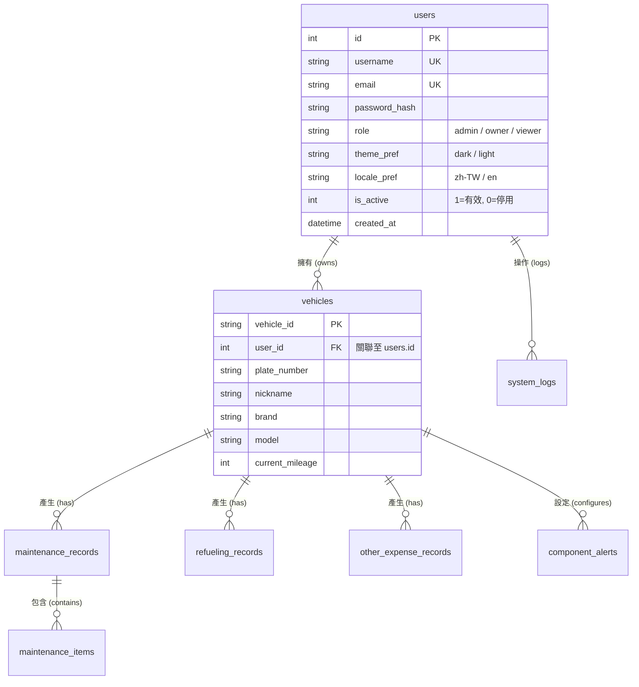

# CarVitals 多用戶車籍與費用管理架構規劃

> **作者**：Office of William  
> **建立日期**：2026-11-26 08:40  
> **狀態**：✅ 規劃完成 — 進入實作

---

## 一、核心需求定義

1. **使用者管理 (User Management)**：
   - 支援系統用戶管理，包括系統管理者 (`admin`)、車主 (`owner` / 一般會員)。
   - 提供註冊、登入、登出、個人偏好設定（主題、語系）與後台使用者管理功能。

2. **車籍與費用資料隔離 (Data Ownership & Isolation)**：
   - **車輛主檔 (`vehicles`)** 增加 `user_id` 欄位作為擁有者關聯。
   - 所有保養維修 (`maintenance_records`、`maintenance_items`)、加油紀錄 (`refueling_records`)、其他費用 (`other_expense_records`)、零件警示 (`component_alerts`) 皆以 `vehicle_id` 為外鍵。
   - **資料隔離原則**：
     - 一般使用者登入後，系統強制限制僅能查詢、新增、編輯自己所擁有的車輛及該車輛所產生的所有紀錄。
     - 系統管理者 (`admin`) 具備全域管理視角，可檢視所有用戶之車輛與費用數據，並可進行跨用戶車輛指派與管理。

---

## 二、資料庫關聯圖 (ER Diagram)

---

## 三、權限驗證與防越權機制 (IDOR Protection)

1. **JWT Session 認證**：
   - 登入成功後，將簽署的 JWT Token 寫入 `HttpOnly`, `SameSite=Lax`, `Secure` 的 Cookie (`session_token`)。
   - Payload 包含：`userId`, `username`, `role`。

2. **後端 API 存取控制層**：
   - **查詢車輛列表**：`SELECT * FROM vehicles WHERE user_id = ?`（Admin 可傳入 `?all=true` 查看全域）。
   - **操作單一車輛**：驗證 `vehicle.user_id === session.userId`（若非擁有者且非 Admin，拒絕存取並回傳 `403 Forbidden`）。
   - **操作單一紀錄**：先透過 `vehicle_id` 向上驗證車輛擁有者是否與當前登入者相符。

---

## 四、歷史資料向後相容移轉

- 目前 Turso 雲端中的既有 3 台車輛（小飛 2553-VY、迷你綠 2G-4730、白玉苦瓜 BGH-2750）及 957 筆歷史資料，將於 Schema 擴充時預設歸屬至 `admin` 帳號（`user_id = 1`）。
- 確保既有完整歷史數據不受任何影響，依然能夠完整查閱。

